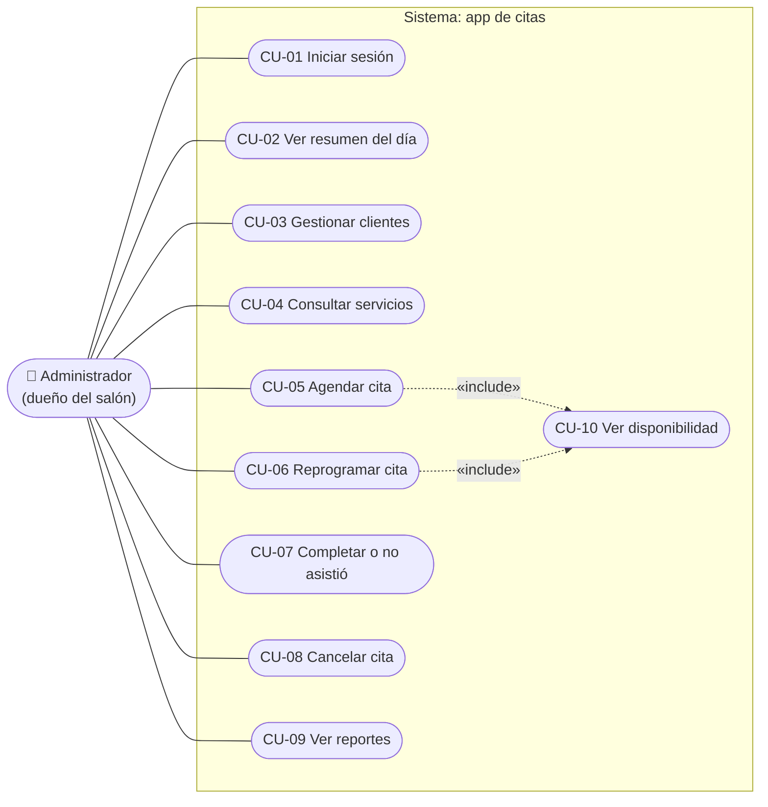
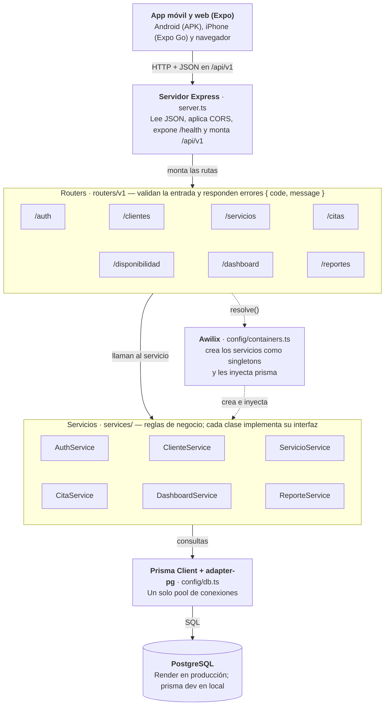
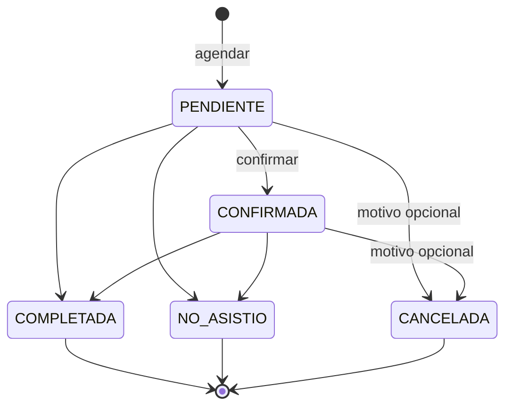

# Documentación – App de agendamiento de citas

Versión del 12 de noviembre de 2026. Presentación: [presentacion.html](presentacion.html).

## Descripción general

Es una app para que el dueño de un salón o spa gestione su agenda: registra clientes, consulta los servicios, agenda citas sin cruces y revisa los ingresos. La usa una sola persona con rol de administrador.

El sistema tiene tres partes en un mismo repositorio: una app móvil y web hecha con Expo, una API REST en Express y una base de datos PostgreSQL. Funciona en Android (APK), en iPhone con Expo Go y en cualquier navegador.

**Usuario de prueba:** `admin@miapp.com` / `123456`.

## Casos de uso

El único actor es el administrador (el dueño del salón). Agendar y reprogramar una cita incluyen siempre la consulta de disponibilidad, que muestra los turnos libres.



| Id | Caso de uso | Flujo principal | Excepciones |
| --- | --- | --- | --- |
| CU-01 | Iniciar sesión | Escribe email y contraseña; la app abre la pantalla de inicio | Credenciales incorrectas (401) |
| CU-02 | Ver resumen del día | Al entrar ve las citas de hoy por estado, la próxima cita, el total de clientes y los ingresos de hoy | — |
| CU-03 | Gestionar clientes | Busca, registra, edita o elimina un cliente y abre su ficha con el historial de citas | Email repetido (409); cliente con citas pendientes no se puede borrar (409) |
| CU-04 | Consultar servicios | Ve el catálogo con duración y precio | — |
| CU-05 | Agendar cita | Elige cliente, servicio y día; ve los turnos libres (CU-10); elige hora y guarda. La cita queda `PENDIENTE` | Fuera de horario (400); turno ocupado (409); servicio inactivo (404) |
| CU-06 | Reprogramar cita | Abre una cita pendiente o confirmada, elige otro día u hora libre y guarda | La cita ya está cerrada (409); turno ocupado (409) |
| CU-07 | Completar o marcar no asistió | Después de la cita la marca `COMPLETADA` (suma a ingresos) o `NO_ASISTIO` | La cita ya está cerrada (409) |
| CU-08 | Cancelar cita | Cancela la cita con un motivo opcional; el turno queda libre | La cita ya está cerrada (409) |
| CU-09 | Ver reportes | Elige un rango de fechas y ve ingresos, citas por estado, tasa de cancelación, clientes nuevos y servicios más pedidos | Rango inválido (400) |
| CU-10 | Ver disponibilidad | El sistema calcula los turnos del día (cada 30 min) como libres, ocupados, pasados o cerrados | — |

## Arquitectura del backend

El backend es una API REST en Express 5 con TypeScript, organizada por capas: cada petición pasa por un router, que valida la entrada, y por un servicio, que aplica las reglas de negocio y consulta PostgreSQL con Prisma.



Los routers no crean los servicios: se los piden a Awilix (`container.resolve`), que los crea una sola vez y les pasa la conexión a la base. Así cada capa se puede cambiar o probar por separado.

| Carpeta | Contenido |
| --- | --- |
| `src/routers/v1/` | Una ruta por recurso; validan parámetros y traducen errores a `{ code, message }` |
| `src/services/` | Lógica de negocio; `interfaces/` define el contrato de cada servicio |
| `src/dto/` | Tipos de entrada y salida de la API |
| `src/config/` | Contenedor Awilix, conexión a la base, URL de la base y horario del salón |
| `src/utils/` | Fechas en hora de Colombia y cifrado de contraseñas |
| `prisma/` | Esquema, migraciones y seed |

**Lenguajes del backend:** TypeScript (ejecutado en Node.js 24), SQL generado por Prisma para PostgreSQL, el esquema de Prisma (`schema.prisma`) y YAML para el despliegue (`render.yaml`).

## Modelo de datos

La base de datos tiene cuatro tablas, definidas en `backend/prisma/schema.prisma`. Las citas guardan una copia del nombre del cliente, del servicio y del precio, para que el historial no cambie si después se edita o se elimina el cliente.

| Tabla | Campos principales | Notas |
| --- | --- | --- |
| Usuario | id, nombre, email, passwordHash, rol | La contraseña se guarda cifrada con scrypt (`salt:hash`) |
| Cliente | id (`c-1`…), nombre, apellido, teléfono, email, activo, fechaRegistro | El email es único |
| Servicio | id (`s-1`…), nombre, descripción, duracionMinutos, precio, activo | Los servicios inactivos no se pueden agendar |
| Cita | id, clienteId, clienteNombre, servicioId, servicioNombre, fecha, hora, horaFin, duracionMinutos, precio, estado, notas, motivoCancelacion | Índices por fecha y por cliente |

**Estados de una cita:**



- `PENDIENTE`: estado inicial al agendarla.
- `CONFIRMADA`: el cliente confirmó que asistirá.
- `COMPLETADA`: el servicio se prestó; cuenta para los ingresos.
- `NO_ASISTIO`: el cliente no llegó.
- `CANCELADA`: se canceló, con un motivo opcional; libera el horario.

Solo una cita `PENDIENTE` o `CONFIRMADA` se puede reprogramar o cerrar. Los otros tres estados son finales.

**Servicios iniciales (seed):**

| Id | Servicio | Duración (min) | Precio (COP) | Activo |
| --- | --- | --- | --- | --- |
| s-1 | Corte de cabello | 45 | 35.000 | Sí |
| s-2 | Manicure | 60 | 30.000 | Sí |
| s-3 | Pedicure | 60 | 35.000 | Sí |
| s-4 | Tinte | 120 | 90.000 | Sí |
| s-5 | Masaje relajante | 60 | 80.000 | No |

## API REST

Todas las rutas cuelgan de `/api/v1` y responden JSON. En producción la URL base es `https://mi-app-api-63nf.onrender.com/api/v1`; en local es `http://localhost:3000/api/v1`. Fuera del prefijo está `GET /health`, que Render usa para saber si el servidor está vivo.

| Método | Ruta | Qué hace |
| --- | --- | --- |
| POST | `/auth/login` | Inicia sesión con email y contraseña (401 si no coinciden) |
| GET | `/clientes?q=` | Lista los clientes; `q` busca por texto |
| POST | `/clientes` | Registra un cliente (409 si el email ya existe) |
| GET | `/clientes/:id` | Ficha de un cliente |
| PUT | `/clientes/:id` | Edita un cliente |
| DELETE | `/clientes/:id` | Elimina un cliente (409 si tiene citas pendientes) |
| GET | `/clientes/:id/citas` | Historial de citas del cliente |
| GET | `/servicios` | Catálogo de servicios activos |
| GET | `/disponibilidad?fecha=&servicioId=` | Turnos del día: libre, ocupado, pasado o cerrado |
| POST | `/citas` | Agenda una cita (409 si se cruza con otra) |
| GET | `/citas?fecha=&clienteId=&estado=` | Lista citas con filtros opcionales |
| GET | `/citas/:id` | Detalle de una cita |
| PATCH | `/citas/:id` | Reprograma fecha u hora |
| PATCH | `/citas/:id/estado` | Marca `COMPLETADA` o `NO_ASISTIO` |
| PATCH | `/citas/:id/cancelar` | Cancela con un motivo opcional |
| GET | `/dashboard/resumen` | Resumen del día para la pantalla de inicio |
| GET | `/reportes/resumen?desde=&hasta=` | Ingresos, citas por estado, clientes nuevos y servicios más pedidos |

**Formato de errores.** Todo error llega con el mismo cuerpo:

```json
{ "code": "CONFLICT", "message": "there is already a cita in that time slot" }
```

| Código HTTP | `code` | Cuándo |
| --- | --- | --- |
| 400 | `BAD_REQUEST` | Faltan campos o el formato es inválido |
| 400 | `FUERA_DE_HORARIO` | La cita queda fuera del horario del salón |
| 401 | — | Credenciales incorrectas en el login |
| 404 | `NOT_FOUND` | Cliente, servicio o cita inexistente |
| 409 | `CONFLICT` | Email repetido o cita que se cruza con otra |
| 409 | `CLIENTE_CON_CITAS_PENDIENTES` | Se intenta borrar un cliente con citas abiertas |
| 409 | `CITA_NO_REPROGRAMABLE` / `CITA_NO_MODIFICABLE` | La cita ya está en un estado final |

**Ejemplo: agendar una cita**

```http
POST /api/v1/citas
Content-Type: application/json

{ "clienteId": "c-1", "servicioId": "s-2", "fecha": "2026-11-20", "hora": "10:00" }
```

Más ejemplos listos para probar en `backend/requests.http`.

## Pantallas de la app

Sin sesión la app muestra solo el Login. Con sesión aparece una barra inferior con Inicio, Clientes, el botón Nuevo (agendar), Citas y Reportes.

| Pantalla | Qué hace | API que usa |
| --- | --- | --- |
| Login | Inicia sesión | `POST /auth/login` |
| Inicio | Resumen del día: citas por estado, próxima cita, total de clientes e ingresos de hoy | `GET /dashboard/resumen` |
| Clientes | Lista, búsqueda, alta, edición, borrado y ficha con historial | `/clientes` y `/clientes/:id/citas` |
| Servicios | Catálogo con duración y precio | `GET /servicios` |
| Agendar cita | Elige cliente, servicio y día; muestra los turnos libres | `GET /clientes`, `GET /servicios`, `GET /disponibilidad`, `POST /citas` |
| Citas | Lista por fecha y estado; reprogramar, completar, marcar no asistió o cancelar | `GET /citas`, `PATCH /citas/:id/...` |
| Reportes | Ingresos, citas por estado, tasa de cancelación, clientes nuevos y servicios más pedidos en un rango de fechas | `GET /reportes/resumen` |

El código de las llamadas a la API está en `frontend/src/api/`: `client.ts` (fetch y errores), `services.ts` (una función por endpoint) y `types.ts` (los mismos tipos del backend).

## Reglas de negocio

1. **Horario:** el salón atiende de lunes a sábado de 08:00 a 18:00, con turnos cada 30 minutos. Una cita debe empezar y terminar dentro de ese horario. Se configura en `backend/src/config/horario.ts`.
2. **Sin cruces:** dos citas no pueden ocupar el mismo horario el mismo día. La hora de fin se calcula con la duración del servicio. Las citas canceladas no ocupan horario.
3. **Turnos pasados:** la disponibilidad marca como pasados los turnos que ya ocurrieron hoy. El servidor usa la zona horaria `America/Bogota`.
4. **Reprogramar y cerrar:** solo se pueden modificar las citas `PENDIENTE` o `CONFIRMADA`. Al reprogramar, el horario actual de la cita no cuenta como ocupado.
5. **Eliminar clientes:** un cliente con citas pendientes o confirmadas no se puede borrar; primero hay que cerrarlas o cancelarlas.
6. **Ingresos:** solo suman las citas `COMPLETADA`, con el precio que tenía el servicio cuando se agendó.

## Instalación y ejecución local

Se necesita Node.js (Render usa la versión 24). No hace falta instalar PostgreSQL: Prisma levanta uno local. Todos los comandos se ejecutan desde la raíz del repositorio.

1. Instalar las dependencias del backend y del frontend: `npm run install:all`
2. Arrancar la base de datos local: `npm run db:local` (se repite después de reiniciar el PC)
3. Crear las tablas y cargar el usuario y los servicios: `npm run db:setup` (solo la primera vez)
4. Arrancar la API en `http://localhost:3000`: `npm run dev:backend`
5. En otra terminal, arrancar la app: `npm run web` (navegador) o `npm run start:frontend` (Expo Go en el celular)

**URL de la API en el frontend.** Se define en `frontend/.env` con `EXPO_PUBLIC_API_URL`. Para usar la API de Render desde cualquier red se deja `https://mi-app-api-63nf.onrender.com/api/v1`. Para usar el backend del PC desde un celular físico se pone la IP del PC (por ejemplo `http://192.168.1.10:3000/api/v1`); el celular y el PC deben estar en la misma red WiFi. Después de cambiar el `.env` hay que reiniciar Expo.

**Otros comandos útiles** (dentro de `backend/`): `npm run db:migrate` crea una migración tras cambiar el esquema, `npm run db:reset` borra y recrea la base, y `npm run db:studio` abre un visor de las tablas.

## Despliegue

El archivo `render.yaml` describe todo el despliegue en Render (plan gratis) y crea tres recursos:

| Recurso | Tipo | Qué hace al desplegar |
| --- | --- | --- |
| `mi-app-api` | Servicio web Node | `npm install && npm run build`; al arrancar aplica migraciones y seed (`db:setup`) y luego `npm start` |
| `mi-app-web` | Sitio estático | `npx expo export --platform web` y publica la carpeta `dist` |
| `mi-app-db` | PostgreSQL | Su URL de conexión llega a la API en la variable `DATABASE_URL` |

**Pasos para desplegar en Render**

1. Fusionar los cambios a la rama `main` con un pull request; Render despliega esa rama.
2. En render.com: New → Blueprint, conectar GitHub y elegir el repositorio. Render lee `render.yaml` y crea los tres recursos. Si el Blueprint ya existe, cada fusión a `main` redespliega solo.
3. Verificar que la API responde en `https://mi-app-api-63nf.onrender.com/health`.
4. Abrir la versión web en la URL que Render asigne a `mi-app-web`.

**Generar el APK de Android** (se compila en la nube con EAS Build de Expo, sin Android Studio)

1. Crear una cuenta gratis en expo.dev.
2. En la carpeta `frontend/`: `npx eas-cli@latest login` y luego `npm run build:apk`.
3. La primera vez, responder **Yes** a crear el proyecto en EAS y a generar el keystore de Android.
4. El build tarda de 10 a 20 minutos y al final muestra un enlace y un QR para descargar el `.apk`.
5. En el celular, descargar el APK y permitir instalar apps de origen desconocido.

El APK ya apunta a la API de Render: la URL está en `EXPO_PUBLIC_API_URL` dentro de `frontend/eas.json`. Si cambia la URL, hay que editarla ahí y generar el APK otra vez.

## Limitaciones y mejoras futuras

**Limitaciones actuales**

- **Plan gratis de Render:** la API se duerme tras 15 minutos sin uso y la primera petición después tarda cerca de un minuto. Antes de una demo conviene abrir `/health` para despertarla.
- **Base de datos temporal:** la base gratis de Render vence a los 30 días; después hay que crear otra o pasar a un plan pago.
- **Seguridad:** el login devuelve un token, pero la API todavía no lo valida en las demás rutas. Cualquiera que conozca la URL puede llamarlas.
- **Un solo usuario:** no hay pantalla para crear usuarios ni roles distintos al administrador.

**Mejoras posibles**

- Validar el token (por ejemplo con JWT) en todas las rutas.
- Mantener la sesión iniciada al recargar la app.
- Gestionar los servicios desde la app (crear, editar, activar).
- Enviar recordatorios de cita al cliente.
